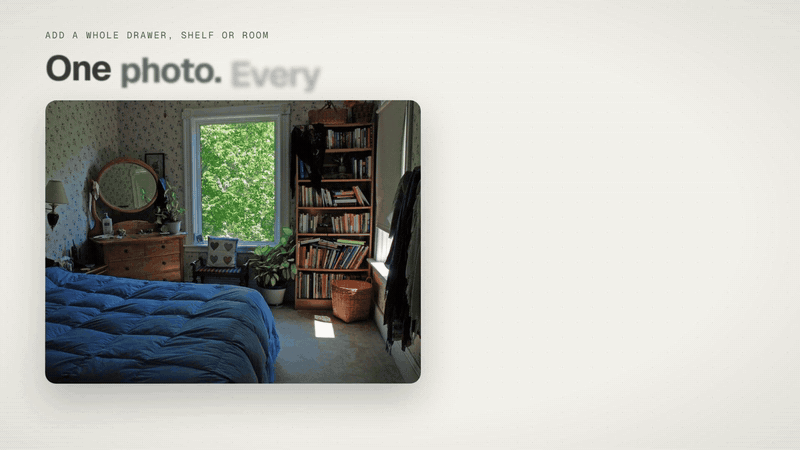

<h1 align="center">OtaghDB</h1>

<p align="center">
  <b>Your room as a searchable database.</b><br>
  Photograph your things as you put them away. Ask where they are later.<br>
  Every AI step runs on open-weight models on your own laptop.
</p>

<p align="center">
  
</p>

<table align="center">
  <tr>
    <td align="center" width="150"><br><b>Qwen3.5 9B</b><br><sub>names, boxes, chat</sub></td>
    <td align="center" width="150"><br><b>SAM 2.1</b><br><sub>cutouts</sub></td>
    <td align="center" width="150"><br><b>SigLIP 2</b><br><sub>search by look</sub></td>
    <td align="center" width="150"><picture><source media="(prefers-color-scheme: dark)" srcset="docs/logos/ollama-dark.svg"></picture><br><b>Ollama</b><br><sub>runs Qwen on the GPU</sub></td>
    <td align="center" width="150"><br><b>Transformers</b><br><sub>runs SAM and SigLIP</sub></td>
  </tr>
  <tr>
    <td align="center" width="150"><br><b>PyTorch</b><br><sub>vision on the CPU</sub></td>
    <td align="center" width="150"><br><b>FastAPI</b><br><sub>vision service</sub></td>
    <td align="center" width="150"><picture><source media="(prefers-color-scheme: dark)" srcset="docs/logos/nextjs-dark.svg"></picture><br><b>Next.js 16</b><br><sub>the app</sub></td>
    <td align="center" width="150"><picture><source media="(prefers-color-scheme: dark)" srcset="docs/logos/sqlite-dark.svg"></picture><br><b>SQLite</b><br><sub>items and search</sub></td>
    <td align="center" width="150"><picture><source media="(prefers-color-scheme: dark)" srcset="docs/logos/tailscale-dark.svg"></picture><br><b>Tailscale</b><br><sub>phone camera link</sub></td>
  </tr>
</table>

<p align="center">
  <a href="#what-it-does">What it does</a> · <a href="#how-it-works">How it works</a> · <a href="#run-it">Run it</a> · <a href="LICENSE">MIT license</a>
</p>

*Otagh* is Persian for room. OtaghDB started with a move into a new place and too many things to remember where they went. You photograph a thing, or a whole open drawer, as you put it away. Local models cut each object out, name it and file it under a room, a piece of furniture and its compartment, like "bedroom, desk, top drawer". Later you ask "where is my passport?" or "I'm going camping for 3 days" and it answers from your own database.

There are no API keys and no cloud calls, and it keeps working with the wifi off. Photos of your things never leave the laptop.

## What it does

- **Add one thing from a photo.** U2-Net removes the background, and Qwen fills in the name, category, color, tags and a short description. You pick the room, and the form suggests the furniture and compartment inside it. If the wrong object was cut out, tap the right one and SAM 2.1 cuts that one instead. The form also warns you when you may already own the thing.
- **Add a whole drawer from one photo.** Qwen finds every object and draws a box around it, and SAM 2.1 cuts them all out in one request. Untick mistakes, tap anything it missed, and save the batch.
- **Furniture with compartments.** A closet, desk, dresser, nightstand, bathroom cabinet, kitchen cabinet or bookshelf comes with its usual compartments. Each compartment knows what normally goes there and warns when something unusual lands in it. Things can also hold other things, like a pouch inside a backpack, and the contents move with their container.
- **A closet view for clothes.** The hanging rod scrolls sideways, folded clothes sit in stacks you tap to open, and filters narrow it down by type, color and what you might give away.
- **Search by name or by look.** "charger" matches names, tags, colors and notes. "something green and leafy" finds the plants through SigLIP 2 image vectors, even when no name matches.
- **Do I already own this?** Point the phone at something in a store. The app shows the closest things you own, each with a similarity score and where it is.
- **Ask and act.** A chat answers from your database and can change it: move things, retag them, add a spot or a compartment, and plan a packing list. Every change shows as a card first, and nothing is saved until you press Apply.
- **Packing lists.** A list groups what you own by room so you can check things off as you pack, and lists the rest as things to buy.

## Coming next

**Pixel room.** Each item already gets a 16-color sprite made from its own cutout. You can drag the sprites around a grid of the room, and their positions save. For now every room gets the same plain grid. Next, the grid becomes a real floor plan with the furniture drawn in.

## How it works

Four open-weight models each do one job:

| Job | Model | License | Runs on |
|---|---|---|---|
| Naming, finding objects with boxes, chat and tool calls | Qwen3.5 9B through Ollama | Apache 2.0 | GPU |
| Background removal | U2-Net through rembg | Apache 2.0 | CPU |
| Tap-to-cut and cutting out boxes | SAM 2.1 hiera-small | Apache 2.0 | CPU |
| Search by look and the "do I own this?" check | SigLIP 2 base | Apache 2.0 | CPU |

- The app is Next.js 16 with TypeScript and Tailwind CSS. SQLite stores rooms, furniture, items and lists, with FTS5 for keyword search and SigLIP vectors stored as blobs.
- A Python vision service (FastAPI, Hugging Face Transformers and CPU PyTorch) serves U2-Net cutouts, SAM 2.1 masks and SigLIP 2 vectors.
- Qwen runs with a 4096-token context, the largest that keeps the model fully on an 8 GB GPU. The other three models run on the CPU.
- For a drawer photo, the server sends Qwen a 1280-pixel copy and asks for every object with a JSON schema. Qwen returns the boxes, and SAM 2.1 cuts all of them out of a 2048-pixel copy in one request.
- The chat is a tool-calling loop on Qwen with 8 tools. Four of them read the database. The other four, which move items, retag them, add spots and plan packing lists, only build a proposal. When you press Apply, the server checks the proposal again and saves it in one transaction.
- Qwen marks each item it mentions with its id. The server drops any id that does not exist, so the chat cannot point at something you do not own.
- A phone joins through Tailscale, which gives the app a private HTTPS address so the live camera works.

Measured on a laptop with an RTX 4060 (8 GB of VRAM):

| Step | Time |
|---|---|
| Add one thing: cutout and name | 7 s |
| Find and cut out 8 objects in one drawer photo | 18 to 22 s |
| Search by name | under 1 s |
| "Do I own this?" check | 1.4 to 2 s |
| Chat move that chains 4 tool calls | 2.7 s |
| Chat packing list for a camping trip | 5.5 s |

[DEMO.md](DEMO.md) has the full demo script with what runs underneath each step.

## Run it

Everything runs on one computer. You need about 8 GB of GPU memory for Qwen, or an Apple Silicon Mac with 16 GB of memory. With less, set `OTAGHDB_MODEL=qwen3.5:4b` and pull that model instead.

The first start of the vision service downloads about 2 GB of models. After that the app works offline.

### Windows

You need Windows 11 with an NVIDIA GPU, [Ollama](https://ollama.com), Python 3.10, Node.js 20.9 or newer, and pnpm.

1. Pull the model:

   ```powershell
   ollama pull qwen3.5:9b
   ```

2. Install the vision service. The CPU build of PyTorch is much smaller than the CUDA one.

   ```powershell
   py -3.10 -m venv services/vision/.venv
   services/vision/.venv/Scripts/pip install torch==2.14.1 torchvision==0.29.1 --index-url https://download.pytorch.org/whl/cpu
   services/vision/.venv/Scripts/pip install -r services/vision/requirements.txt
   ```

3. Install the app and start everything:

   ```powershell
   pnpm install
   .\start.ps1
   ```

`start.ps1` starts Ollama and the vision service if they are not running, loads Qwen onto the GPU and checks that it fits fully. It then builds the app when the code changed and serves it at http://localhost:3100. Use `.\start.ps1 -Dev` while developing.

### macOS

You need an Apple Silicon Mac and [Homebrew](https://brew.sh).

1. Install the tools, start Ollama and pull the model:

   ```bash
   brew install ollama python@3.12 node pnpm
   brew services start ollama
   ollama pull qwen3.5:9b
   ```

2. Install the vision service:

   ```bash
   python3.12 -m venv services/vision/.venv
   services/vision/.venv/bin/pip install torch==2.14.1 torchvision==0.29.1
   services/vision/.venv/bin/pip install -r services/vision/requirements.txt
   ```

3. Install the app and start everything:

   ```bash
   pnpm install
   ./start.sh
   ```

### Linux

You need an x86_64 machine with an NVIDIA GPU and its driver, Python 3.10, 3.11 or 3.12 with the `venv` module, Node.js 20.9 or newer, and pnpm (`npm install -g pnpm`).

1. Install Ollama and pull the model:

   ```bash
   curl -fsSL https://ollama.com/install.sh | sh
   ollama pull qwen3.5:9b
   ```

2. Install the vision service. The CPU build of PyTorch is much smaller than the CUDA one.

   ```bash
   python3 -m venv services/vision/.venv
   services/vision/.venv/bin/pip install torch==2.14.1 torchvision==0.29.1 --index-url https://download.pytorch.org/whl/cpu
   services/vision/.venv/bin/pip install -r services/vision/requirements.txt
   ```

3. Install the app and start everything:

   ```bash
   pnpm install
   ./start.sh
   ```

`start.sh` does the same as `start.ps1`. It runs Ollama and the vision service in the background if they are not running, and writes their logs to `data/ollama.log` and `data/vision.log`. Ctrl+C stops the app and the services the script started. Use `./start.sh --dev` while developing.

We built and tested OtaghDB on Windows 11. The Mac and Linux steps install the same package versions, and every Python package has a prebuilt wheel for Apple Silicon and Linux x86_64. We have not yet run the whole app on a Mac or Linux machine.

### Phone camera

To take photos with a phone, install [Tailscale](https://tailscale.com/download) on the computer and the phone, and sign both in to the same tailnet. The start script then shares the app at a private HTTPS address, and the Phone page in the app shows it as a QR code. The live camera needs that HTTPS address. On plain wifi, the Camera button opens the phone's camera app instead.

On a Mac, the app needs the `tailscale` command on the PATH. Install the Standalone Tailscale app from the download page and turn on CLI integration in its settings. The Mac App Store version does not add the command.

### Settings

| Variable | Default | What it changes |
|---|---|---|
| `OTAGHDB_MODEL` | `qwen3.5:9b` | The Ollama model for naming, boxes and chat |
| `OLLAMA_URL` | `http://127.0.0.1:11434` | Where the app finds Ollama |
| `VISION_URL` | `http://127.0.0.1:7000` | Where the app finds the vision service |

Photos and the database live in `data/`, which is not committed, so pictures of your things stay on your computer.

## More

- [DEMO.md](DEMO.md) is the live demo script, with what happens underneath each step and measured timings.
- [PLAN.md](PLAN.md) is the build plan: why each tool was picked, the data model, the memory budget and the risks.
- [video/](video/README.md) is the demo video, written in code with Remotion. It animates real output from the app and its models, with a Kokoro voiceover.

## License

OtaghDB is under the [MIT license](LICENSE). The four models are under Apache 2.0. The logos above belong to their owners.
